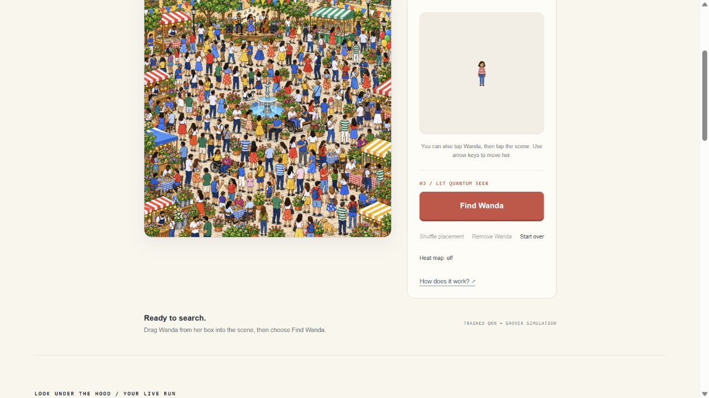

# Where’s Wanda — iteration 18 handoff

[Open the owner-private website](https://quantum-crowd-search.syrupyspool2.chatgpt.site).
The game now starts with an empty Festival scene. Exactly five named map
thumbnails sit in one row above it, and a large Wanda portrait in the right-hand
welcome box says: “Hi, I’m Wanda! Drag me into the scene, and let quantum crowd
search find me!” Dragging hides that portrait and shows a small Wanda centered
at the cursor; dropping into the map inserts the normal 52px sprite. Find
remains in the right-hand menu. Remove returns her to the box; Start over
restores the empty Festival scene.

The existing connected **Image + QNN → Grover interference → Measurement**
explanation is preserved, including exact layer playback and the Grover guide.
No model, threshold, artwork, classifier inputs or quantum mathematics changed.
The interface preview is never part of the analyzed image before a real drop.

## Actual checks and retained failure

- All **147 Node engineering tests** pass. JavaScript syntax, diff checks,
  markup/selector/CSS checks and the read-only frozen verifier pass: 11 files,
  seven source contracts and 12 pixel fixtures, including the metadata erratum.
- Local native drag placed Wanda at (420,300); Find returned that point.
  An outside-map drop restored the portrait without insertion. Empty Festival
  accepted 0/4096 addresses and reported No match found. All five scenes work
  with the empty welcome state.
- Keyboard activation focuses the map before insertion; Escape returns focus
  to the portrait, and map Enter places her. Remove and Start over restore the
  welcome box. Actual 320px and 390px viewports keep all five choices on one
  row without document overflow. Find’s menu position was unchanged by
  placement in the 390px check.
- The first private revision, source `20ceda2fdadafab8c9c8fd6761963b539676a048`,
  deployment `appgdep_6acbca29dbf08191af93b83aaef2b98b`, placed successfully
  but the user reported an invisible cursor preview. The detached native drag
  canvas was replaced by an explicit fixed image updated by native drag and
  document dragover events. This failure is retained, not counted as a pass.
- The corrected local native gesture showed a decoded 17×61px preview at its
  displayed scene scale. The final hosted native gesture showed a decoded
  13×45px preview at the hosted display scale, then hid the source portrait
  after the map drop. Hosted Find returned **Measured point 420,300 / Found
  Wanda**. Start over restored the greeting, portrait and five choices. Local
  and hosted error/warning consoles were empty.

Read [the source QA](waldo-search-lab/docs/WANDA_ITERATION18_QA.md),
[quick-start](WANDA_QUICKSTART.md) and [exact receipt](publication-receipt.json).
The earlier body and its actual QNN/Grover checks are preserved in
[iteration 16’s archived handoff](archive/WANDA_HANDOFF-iteration16.md).
[Iteration 17’s rehearsal](WANDA_ITERATION17_HANDOFF.md) remains historical:
its tool-driven 237.405-second run did not establish a two-minute spoken demo.
The [rehearsal script](WANDA_DEMO_REHEARSAL.md) now notes the empty-start intro.

## Exact private release and scientific scope

Source `17bd16281b095f3ab664f9e0c1396dfa3ee0a028`; version
`appgprj_6ac9ed0456008191aafac54f8d5af4d1~appgver_d3687cf4d9e481918e246734744dd103`; deployment
`appgdep_6acbcbc430648191ac8d657a9523f362`: terminal **succeeded** on the existing crowd Site.
Owner/custom access remains one user, zero groups and zero external visitors.
The separate schoolbus deployment and both Site identities are preserved.

The frozen Wanda model remains
`d1f49aa304668d2826f36652ac70d0f51b64dc4eb86acfd2c0e7804f80ff4c88`,
threshold `0.9056472752971427`. Historical native 298/300 versus the matched
classical baseline’s 299/300 concerns the known PNG, five original unseeded
scenes, supplied scales and fully visible placements. It is not new evidence
for this interface. Original misses, renderer differences, and the curated
Park lookalike’s 40/46px false acceptances are retained. No training, reserved
test rerun or expanded accuracy claim occurred.

Physical touchscreen/pen gestures, multi-touch, OS reduced-motion preference
and unfamiliar-user learning were not tested in this step. Touch/pen handlers
are implemented; actual responsive and keyboard checks do not prove physical
touch behavior. The prior portable-startup proof remains the
[iteration 14 package audit](WANDA_ITERATION14_PACKAGE_AUDIT.md), with its npm
installation and cross-platform limits. No arbitrary-person recognition,
unknown-scale detection, occlusion, quantum hardware or end-to-end quantum
speedup is established.

## Resume here

Build on this published empty-start drag/place/find loop. Keep the same three
technical stages and address the next observed usability gap; check physical
touch/pen behavior when available. Before privately rehearsing the old script,
place Wanda near (420,300) and time the new welcome step. Preserve frozen
evidence and predeclare any future domain/model study rather than reopening
the existing reserve.

The user authorized synchronization to the existing private
`goesixteen/quantum-image-search` repository. Read
[its exact synchronization receipt](GITHUB_SYNC_RECEIPT.json) for the GitHub
commit actually pushed; Sites and GitHub have separate histories. Source ZIP
and publication records are refreshed separately by root after these docs.
No contest, public source/video or Qollab publication/submission is authorized.

The hourly heartbeat remains active. Maximum one agent usage reset tonight;
**zero agent resets consumed, one reset remaining at the latest observation**.
The earlier account change from two to one had an unknown actor/cause. Preserve
the remaining reset for the user and read
[the resource ledger](OVERNIGHT_RESOURCE_BUDGET.json) at every resumption.
No reset, purchase or billing change was performed by the agent.

