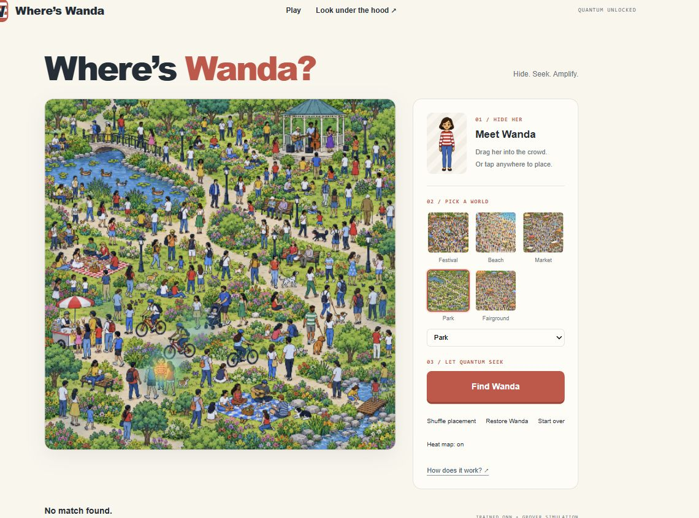
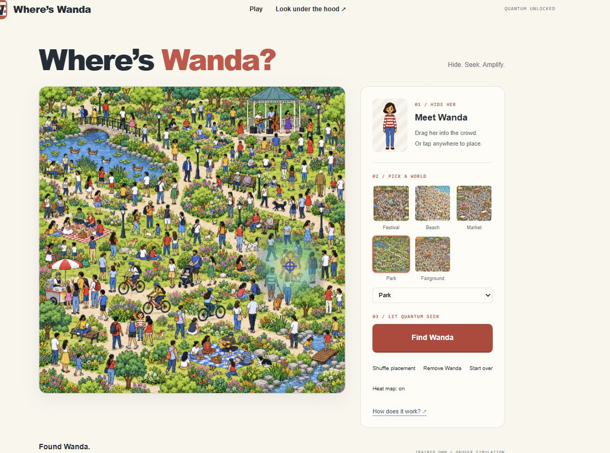

# Iteration11 private deployment checks

Recorded 2026-10-11T06:48:08.132205+00:00. Exact commit `af83edd7fa01f026d3df1aa568a740a52495d63b`, version `appgprj_6ac9ed0456008191aafac54f8d5af4d1~appgver_64658d73a63881918bc4a6907031d93b`, deployment `appgdep_6acb2f2906688191babcf44c9b5b3fc1`, status **succeeded**. Owner/custom audience:1user,0groups,0external visitors.

Actual deployed Chromium page: five worlds; default trained Wanda QNN; height52; weak-clue boost off, exposure1, amplification emphasis100%. CuratedPark absent:0accepted, strongestwindow172396 at70.21%, No match found, no sampling. RestoreWanda420300 and Find: exactly1accepted, peak50, measured420300, centererror0.5px. Final consoleerror check empty. Actual proof screenshots saved below. These confirm deployed defaults, not independent accuracy or all-size identity recognition. Smaller40/46 falsematches remain documented.

