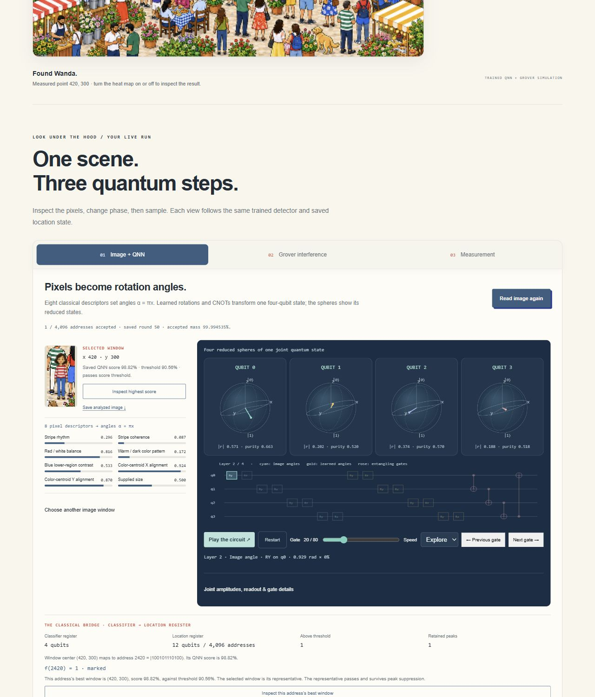
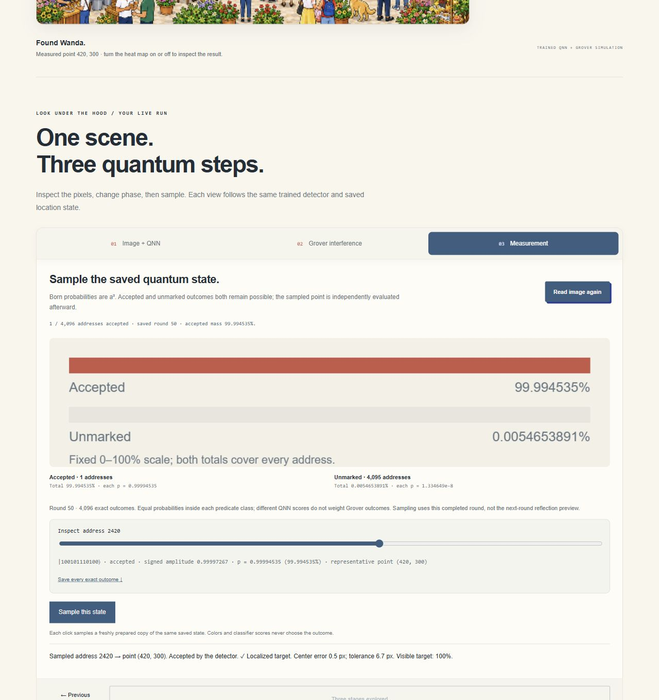

# Iteration 12 private deployment checks

Recorded 2026-10-11T07:25:18.690451+00:00. Exact source `f5e429a94f885dc8afd1469079ca69f065c8cd56`, version
`appgprj_6ac9ed0456008191aafac54f8d5af4d1~appgver_b492680b4720819188058fc9b5ed8649`, deployment `appgdep_6acb38e5baa881919a77eec0bb38408a`: **succeeded**.
Owner/custom audience: one user, zero groups and external visitors.

Final owner-private revision f5e429a94f885dc8afd1469079ca69f065c8cd56 is terminal-deployed and verified in actual Chromium. One connected three-stage explainer, actual QNN crop/reduced states, phase/probability semantics and current-round sampling work. Empty Park52 abstains. The inspected-address slider repair is verified; final proof captures replace the intermediate capture, which is archived.

- Default Festival: exactly five worlds, trained QNN, three tabs, one active panel, optional advanced/evidence disclosures.
- Reading builds address2420 at round0 and waits without measurement; phase keeps accepted0.024414063%. Reflection preview and saved-round distinction are verified.
- First peak50: accepted99.994535%, unmarked0.0054653891%, per-unmarked1.334649e-8. Actual sample2420 reports(420,300),0.5px center error and100% visibility.
- Final repair: sample2420 synchronizes range/label2420; ArrowRight synchronizes both2421 and shows exact negative amplitude/unmarked tail. The recorded sample remains2420.
- Final gate20 shows real reduced Bloch lengths0.571/0.202/0.374/0.188 while preserving saved round50. Screenshot includes actual crop, descriptors, circuit and four spheres.
- Final empty Park52: zero accepted, no answer, sampling disabled; highest(172,396) score70.21% remains below threshold.
- No console errors observed. Start over leaves Festival52,64×64 and Ready to search for review.
- Postpublication audience verified owner/custom:1user,0groups,0external visitors. Both Site identities and bus deployment preserved.

