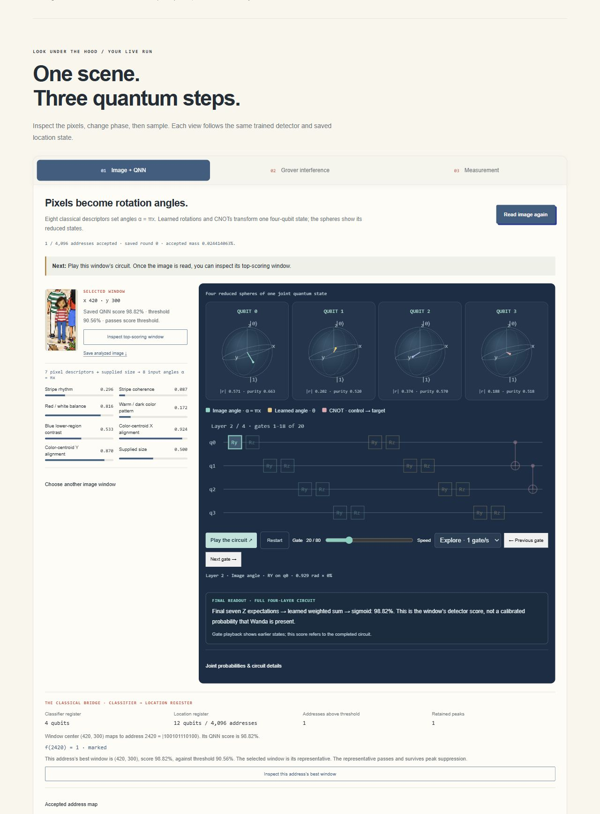
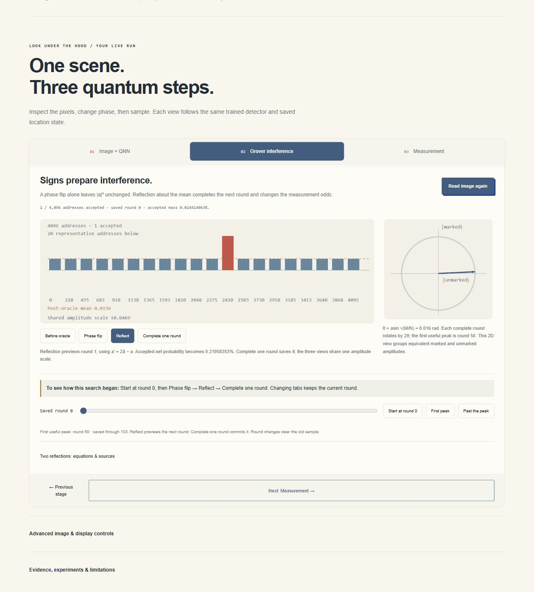
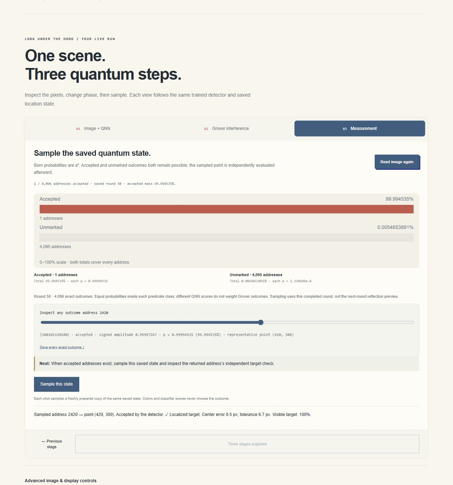
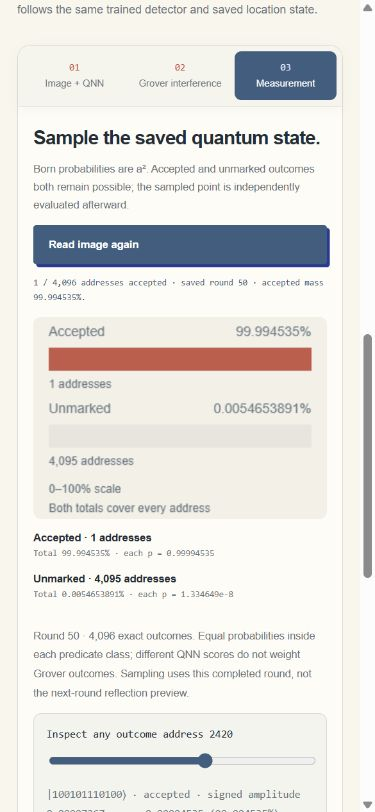

# Iteration 13 private deployment checks

Recorded 2026-10-11T08:18:24.188036+00:00. Exact source `d14bf6a99c8dfc1513d3290ed36e6c474e4ad896`, version
`appgprj_6ac9ed0456008191aafac54f8d5af4d1~appgver_81a54d9fa44481919f79d5d15374683d`, deployment `appgdep_6acb4488c1688191b4163aa2c3d07dd4`: **succeeded**.
Post-deployment audience: owner/custom, one user, zero groups/external visitors.

Private responsive three-stage quantum walkthrough is terminal-deployed and verified in actual Chromium. Full-circuit readout, genuine reduced Bloch states, phase/preview/saved-round semantics and all 4,096 exact probabilities remain correct. Phone resizing preserves the run, default empty Park abstains, and keyboard Find works. Frozen model/threshold/evidence unchanged.

- Exact source d14bf6a99c8dfc1513d3290ed36e6c474e4ad896 deployed successfully to the existing Site; post-deployment owner/custom audience remains one user, zero groups/external visitors.
- Actual Chromium shows the final descriptor wording, visible angle legend/full-circuit readout, all five worlds and only three primary stages.
- Read image waits at round 0 without sampling. Phase leaves 0.024414063% mass unchanged; reflection previews round 1 at 0.21958353%, then saved round commits.
- At peak 50 the actual sample is 2420 → (420, 300), center error 0.5px. Inspector range/text agree; all 4,096 exported amplitudes/probabilities exactly match the local JSON export.
- 390px layout has no horizontal overflow,305px × 210px measurement canvas and6 of 20 labelled circuit slice; resizing/tab reveal retains gate 20 / round 50 / sample 2420.
- Park 52px absent has zero accepted addresses, uniform state, disabled sampling and qualified sampling cue. No forced answer.
- Keyboard target movement then Enter completes a real search, returning (420, 300) with 2.1px center error. This is an engineering check, not new accuracy.
- No local or hosted browser errors/warnings observed. Normal viewport restored; temporarylocal QA tabsclosed and existinguser review tabs preserved.

## Limits

- Engineering and heuristic walkthrough checks, not a human learning study or new held-out recognition evidence.
- Historical298/300 native result belongs to original unseeded scenes. Curated Park40/46 false acceptances and renderer differences remain recorded.
- Known Wanda, supplied scale, simulated quantum circuit; no arbitrary-person recognition, occlusion, hardware execution or end-to-end speedup claim.

