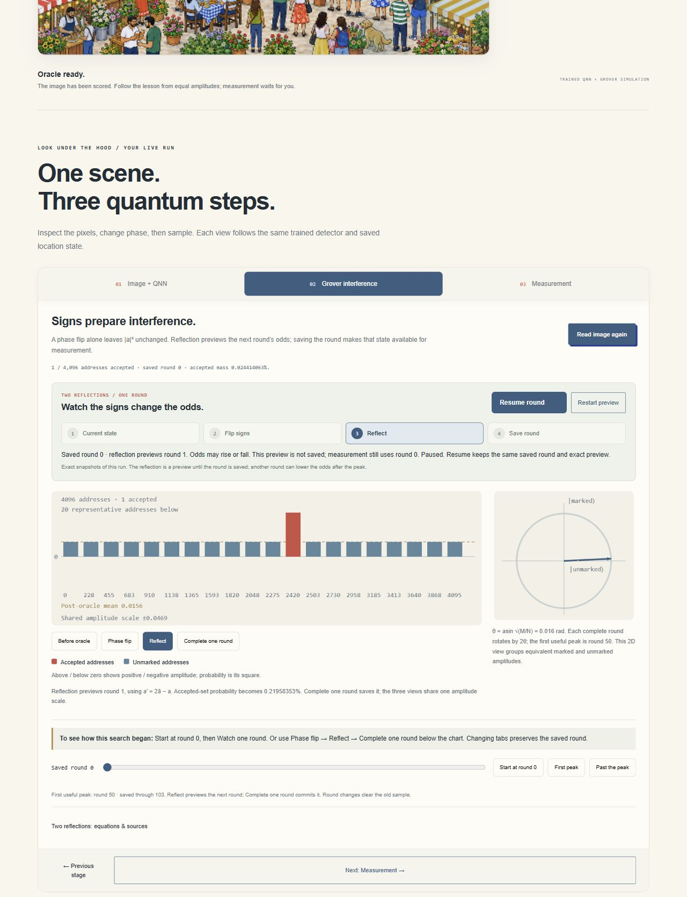
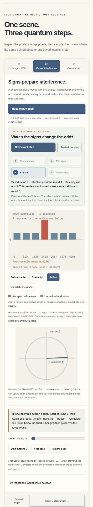

# Iteration 15 private deployment checks

Recorded 2026-10-11T10:21:14.708449+00:00. Exact source `a5b285dc484a6db9a35d806c21de36caa652bd93`, version
`appgprj_6ac9ed0456008191aafac54f8d5af4d1~appgver_4845d0befa308191828bfbeaed73088b`, deployment `appgdep_6acb626b9bb48191ac72b5fa1984de6a`: **succeeded**.
Post-deployment audience: owner/custom, one user, zero groups and zero external
visitors. The schoolbus deployment is unchanged.

One exact Grover round now has visible sign-flip, reflection-preview and save steps, Pause/Resume, and explicit reduced-motion stepping inside the existing three-stage lesson. Final private fresh-load, exact-state, default-game, phone and empty-scene checks pass after fixing a real module-arrival race.

- Exact final source a5b285dc484a6db9a35d806c21de36caa652bd93 deployed terminal-succeeded to the existing owner-private Site. Post-deployment owner/custom audience remains one user, zero groups and external visitors.
- Fresh final hosted page initialization enables Read this image without Find; reader says Window inspection is ready. Read builds a saved round0 oracle without sampling.
- Final hosted Watch one round shows oracle then exact reflection, with Pause/Resume. Reflection note explicitly distinguishes saved round0 from preview round1 and Measurement still uses saved0.
- Final guided round1 commits once without sampling. All4096 exported amplitudes/probabilities exactly equal the local UI export; norm1, accepted mass0.0021958353463560343, and max p=a² error zero.
- Default final hosted Find with visible reduced-motion control returns point420,300. Guide does not change the default search or detector.
- Final hosted390×844 fresh page enables Read; document375px wide,2×2 guide steps, no horizontal overflow. Three explicit clicks preview reflection at saved0; fourth commits1 without a sample. Phone proof captures that distinction.
- Final empty Park52 gives zero accepted addresses, no reported answer/sampling and disabled guide. No desktop/phone console errors/warnings. Viewport restored, temporary QA tabs closed, final review retained.
- Initial iteration15 deployment dfadd066622f5874504fb001f4d908ba0d51cafd exposed the missed initial scene event. It was repaired and privately redeployed rather than marked successful for cold startup; original release IDs/failure are retained.

## Evidence and limits

- Engineering/heuristic UX checks, not a human learning study or new reserved recognition result.
- Historical native298/300 belongs to original unseeded backgrounds; Park40/46 false acceptances and native/browser resampling differences remain preserved.
- Known Wanda PNG, supplied size, fully visible targets, classical descriptors and simulated trained QNN; no arbitrary-person, unknown-size, occlusion, hardware or end-to-end speedup claim.
- Physical document visibility and OS motion preference were not directly altered/tested. Hidden-stage behavior is browser-checked, timer/visibility policy unit-tested.
- Prior portable audit uses exact installed Windows dependencies copied to fresh extraction; npm installation and cross-platform execution remain untested. Final bundle verification is recorded separately after packaging.

These are guided-round and interaction checks, not a new recognition benchmark or
a human learning study. The model, threshold, historical results and retained
Park size failures remain frozen. Read [the quick-start](WANDA_QUICKSTART.md),
[package audit](WANDA_ITERATION14_PACKAGE_AUDIT.md) and
[current handoff](WANDA_HANDOFF.md). No contest/public submission occurred.

