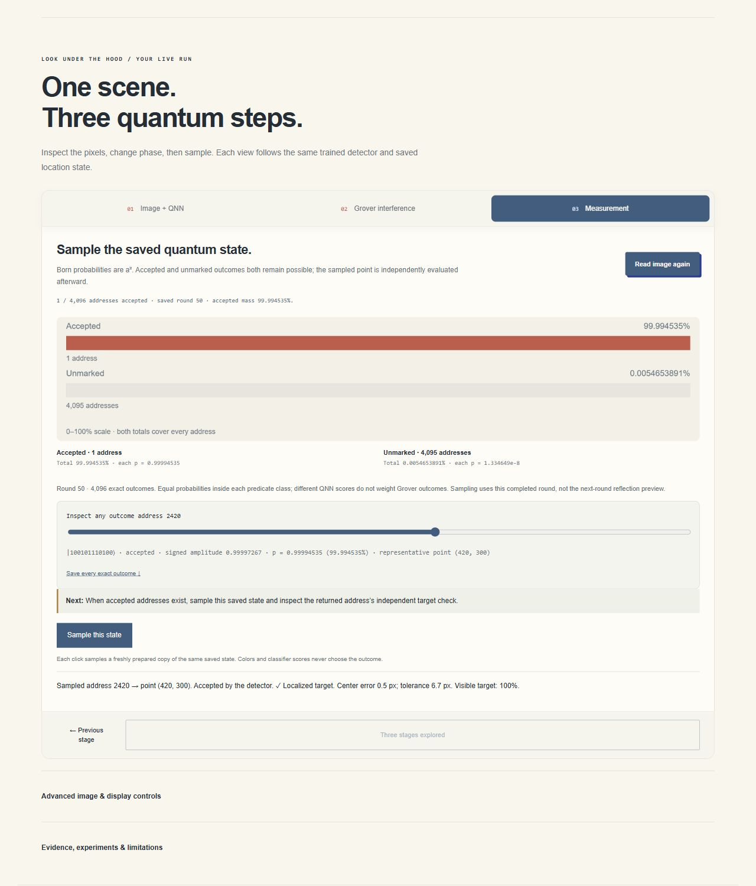

# Iteration17 — private rehearsal and continuation

Completed a bounded documentation/rehearsal step from published iteration16.
Read the project state, run log, brief, exact receipt, bundle checks and budget.
The crowd source remains `2f3f836e5d13df81f32abc040f101a2959c04ee0`;
deployment `appgdep_6acb6db2fa84819194c044f570f6c8db` is the latest publication.
No new site version, model, threshold, artwork, training or recognition study.
Both Site identities and the schoolbus deployment are preserved. Nothing submitted.

## Completed

Created [a private two-minute demo script](WANDA_DEMO_REHEARSAL.md), with accurate
actions, narration, preflight, question answers and retained limits. Independent
bounded read-only scientific review informed the wording. Fast4gates/s is
explicitly required to fit four20-gate layers into approximately20seconds;
Explore speed would use approximately80seconds. Human spoken timing is untested.

Actual owner-private browser walkthrough used Start over/defaultFestival52px,
Find, top-scoring window, Fast and four explicit layer plays. Automatic stops
were20/40/60/80; final Play was disabled. The inspected window was420,300,
score98.82%, threshold90.56%. Circuit inspection retained Grover round50,
accepted mass99.994535%. Start at round0 gave0.024414063% accepted mass.
Oracle preview reversed signs without changing probabilities; reflection was
explicitly labelled an unsaved preview of round1. Watch one round saved one
round without sampling. First peak selected the already computed exact round50.
One manual sample returned address2420, point420,300, center error0.5px,
tolerance6.7px,100% target visibility. No re-sampling or outcome filtering.
No console errors/warnings. Temporary rehearsal tab closed; review tabs retained.

The tool-driven run took **237.405seconds**, including calls, inspection and
pauses. This is not a two-minute spoken rehearsal, audience study, runtime
benchmark or new recognition accuracy. The script's two-minute target remains
to be tested by a human. No broad tests were rerun for these documentation edits;
the unchanged release's147 passing tests and prior package proof retain scope.

## Budget and next start

Start observation:99% weekly usage, ordinary usage allowed,2resets available.
Zero agent resets consumed. No callable reset operation was exposed; none was
performed. At most1overnight reset is authorized, and1must remain for personal
use. Do not purchase credits or change billing. Re-read the ledger and current
limits on resumption rather than treating this observation as live.

Next: privately time a spoken walkthrough if voluntary feedback is available,
then fix the actual comprehension or interaction gap. Keep the three stages,
frozen evidence, known Park40/46 failures and no-submission constraint. The
publication receipt correctly remains iteration16; this document is a local
continuation, not a new deployment receipt.

