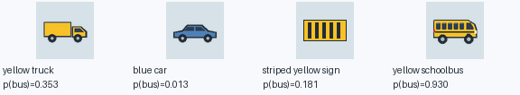

# A learned classifier event inside coherent amplitude amplification

This research appendix trains the **QNN output qubit itself** to recognize synthetic bus patches, then amplifies that learned event with an actual unitary preparation A and its gate-reversed inverse A†. There is no sigmoid, learned classical readout, threshold, or intermediate measurement in the coherent experiment. The working illustrated and photo UI models remain unchanged.

The exported classifier is `../model/coherent-classifier.json`; training, classification results, and six-qubit coherent diagnostics are in `../model/coherent-classifier-metrics.json`. The experiment uses the existing `coherent_prototype.py` gate preparation and amplification functions, with newly learned circuit angles.

## What is trained

Four qubits start in |0000⟩. The eight engineered pixel features and reuploading gate sequence are the same as the illustrated model: per layer, encode RY(πf[q]) and RZ(πf[q+4]), apply variational RY/RZ rotations, then the CNOT ring 0→1→2→3→0. The classifier score is directly

`p(bus | patch) = P(output qubit 3 is measured as 1) = (1 − ⟨Z3⟩) / 2`.

This denotes the circuit's learned event probability, not a guaranteed or calibrated posterior of the true semantic label. No classical coefficients or bias transform the expectation value. Training optimizes the circuit angles using analytic statevector derivatives and weighted binary cross entropy: negative examples have weight 2, fixed before the run. This penalty favors lower background event probability, which matters when many candidate addresses are amplified together.

Four-layer and six-layer candidates each received three seeded starts and 2,000 Adam steps per start. The lowest validation weighted BCE selected **four layers, restart 2, step 1900**. Six layers did not improve this objective in the tested starts. The exported circuit has 32 angle slots. Four final RZ angles alter phases without changing computational-basis output probabilities, so **28 slots affect the classifier probability**; the artifact records both counts. Independent derivative checks confirm this output-insensitive final phase block.

## Classification quality

The procedural dataset is unchanged from the illustrated experiment: varied yellow buses, partial fragments, neutral backgrounds, negative cars/vans/trucks, striped signs, rectangles, clutter, and empty patches. The data counts and seeds are identical to its reproducible baseline.

| Split | Count | Seed | Accuracy at p≥0.5 | Precision | Recall | AUROC |
|---|---:|---:|---:|---:|---:|---:|
| Validation | 800 | 20261011 | 93.75% | 96.05% | 91.25% | 0.979931 |
| Held-out test | 2,000 | 20261112 | **92.25%** | 94.24% | 90.00% | 0.981333 |
| Stress test | 1,200 | 20261113 | **89.83%** | 92.68% | 86.50% | 0.971400 |

The validation F1 diagnostic threshold is 0.48; it gives 92.20% held-out accuracy and is not used by the coherent routine. At p≥0.5, the test confusion matrix is TP=900, FP=55, FN=100, TN=945. Mean test probability is 0.8170 for bus patches and 0.2161 for negative patches. The raw-event classifier has lower classification accuracy than the illustrated hybrid model's 96.95%; it provides a directly coherent learned output event that the hybrid sigmoid score does not supply.

This experiment concerns synthetic patches and a particular engineered-feature ansatz. It does not test photographs, unseen bus identities, quantum hardware, or a computational advantage over classical classification.

## Actual coherent preparation and amplification

Two address qubits initialize four regions uniformly. Each address conditionally encodes its eight feature values, while all branches share the learned QNN angles. The total preparation uses six qubits and 178 logical primitive operations, including address-controlled rotations whose physical multi-control decomposition is not supplied. Feature extraction and construction of the four-row angle table are classical preprocessing.

The prepared state is `|Ψ⟩ = ½ Σ_i |i⟩ Uθ(f_i)|0000⟩`. A good basis state has output bit q3=1. The phase reflection S_good acts on that bit; S0 flips only the full six-qubit zero state. Iteration applies `Q = −A S0 A† S_good`. With initial event probability `a = ¼ Σ_i p_i`, the event curve is `P_good(k) = sin²((2k+1) asin√a)`. This is the standard amplitude-amplification construction for a measurement-free A. [Brassard, Høyer, Mosca, and Tapp, section 2](https://arxiv.org/pdf/quant-ph/0005055).

Projecting the prepared good component gives `P(address=i | q3=1) = p_i / Σ_j p_j`. Q scales that whole component; it does not change its internal address proportions. The implementation verifies this invariant numerically at every iteration.

## Fixed semantic example

These four exemplars were specified before training, rather than chosen to maximize the resulting demonstration. They include two yellow nonbus distractors.

| Address | Actual patch | Learned raw event probability |
|---:|---|---:|
| 0 | Yellow truck | 0.352572 |
| 1 | Blue car | 0.012531 |
| 2 | Striped yellow sign | 0.181115 |
| 3 | Yellow schoolbus | **0.930333** |



The initial bus address marginal is 25%. The circuit-native good event starts at 36.91%; conditional on that event, the bus address has probability 63.01%. One amplification round raises the good-event probability to **85.67%**, the joint bus-and-good probability from **23.26% to 53.98%**, and the bus address marginal to **54.38%**. Conditional bus probability remains **63.01%**.

| Rounds | Output-bit good event | Joint bus and good event | Bus address marginal |
|---:|---:|---:|---:|
| 0 | 36.91% | 23.26% | 25.00% |
| 1 | 85.67% | 53.98% | 54.38% |
| 2 | 1.51% | 0.95% | 3.67% |

Amplification increases the chance of observing the classifier's accepted event. Its false-positive probability is still present inside the accepted subspace, as the truck and sign illustrate. The invariant conditional weights make this limitation explicit: amplification cannot repair a mistaken or uncertain classifier event. As the number of negative regions grows, their aggregate soft acceptance weight becomes a serious scaling issue. More precise raw-event training or coherently sharpening several classifier outcomes would be a separate research step; it would still need to address systematic misclassification.

## Numerical verification and reproduction

Requirements are Python 3, NumPy, and Pillow, with exact tested versions in `../model/requirements.txt`. No quantum SDK, GPU, hardware service, or network download is required to run this local experiment.

From the project root, reproduce training and all embedded checks:

```sh
python -m pip install -r model/requirements.txt
python model/train_coherent_classifier.py --steps 2000 --restarts 3 --negative-weight 2
```

Verify the frozen checkpoint without retraining or rewriting artifacts:

```sh
python model/train_coherent_classifier.py --verify-only
```

The lightweight verifier is in the training script; no separate test script is needed. It has already passed for the frozen export. It independently checks A† against the dense conjugate transpose, A's unitarity, recovery of |0⟩, Q against a dense reflection operator, the analytic amplification curve, state normalization, branch probabilities against the classifier's Born probabilities, conditional address invariance, and analytic circuit derivatives against parameter-shift expectations. The largest coherent consistency error is 5.78×10⁻¹⁵; derivative agreement is within 5.69×10⁻¹⁶.

Outputs:

- `../model/train_coherent_classifier.py`: deterministic trainer, actual coherent experiment, and `--verify-only` entry point.
- `../model/coherent-classifier.json`: circuit angles and model configuration, without a sigmoid/readout/bias.
- `../model/coherent-classifier-metrics.json`: all candidate histories, selection record, classification results, coherent trajectories, and checks.
- `../model/coherent-exemplars.png`: the four fixed patches and their learned probabilities.

The model can be used by `coherent_prototype.preparation_gates`, `apply_circuit`, and `amplify` directly, as this script does. The older prototype CLI's sigmoid-only diagnostic helper is not the entry point for this raw classifier. The learned event is a stronger semantic research foundation for a future coherent demo, while the deployed CAPTCHA interfaces retain their validated hybrid classifiers.
