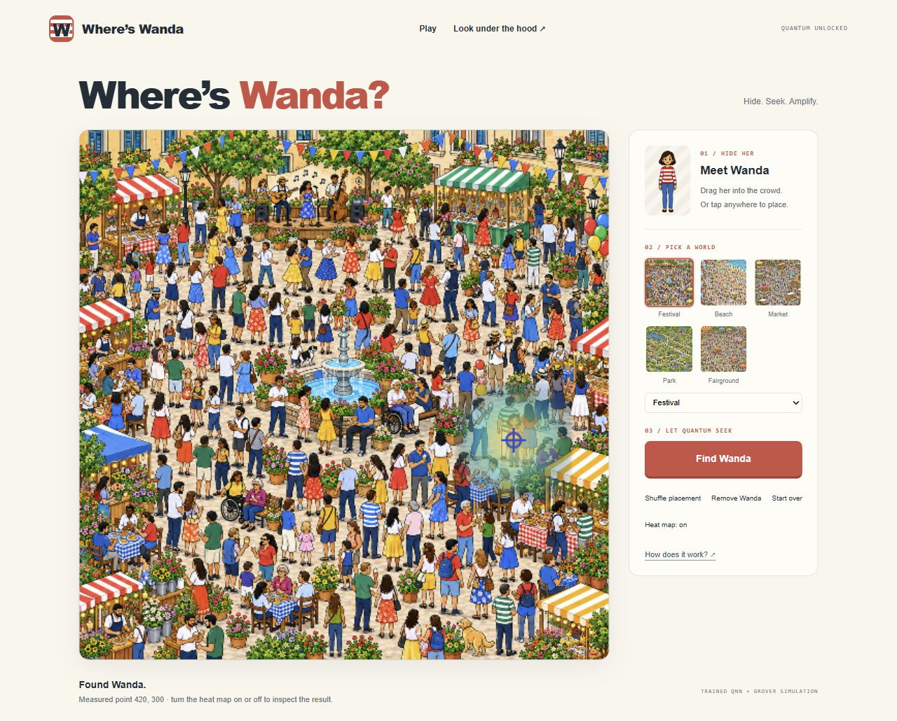
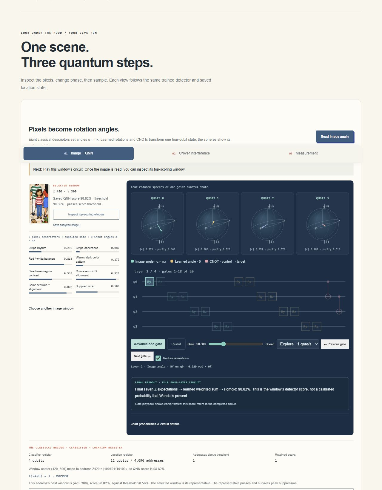
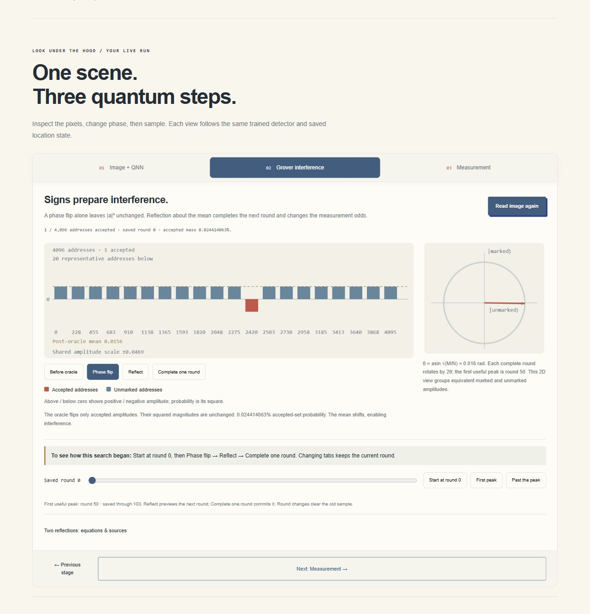
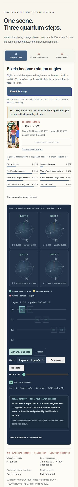

# Iteration 14 private deployment checks

Recorded 2026-10-11T09:25:53.149557+00:00. Exact source `f8090bd03045d350bdb6d2e9133c0e882887a3b8`, version
`appgprj_6ac9ed0456008191aafac54f8d5af4d1~appgver_9b48a7cb5724819195d907ec353d4c4b`, deployment `appgdep_6acb5549b6bc8191aea20694b9916792`: **succeeded**.
Post-deployment audience: owner/custom, one user, zero groups and zero external
visitors. The schoolbus deployment is unchanged.

Private five-world game and connected three-stage quantum explanation have working Stop/Escape cancellation, visible reduced-animation controls, signed amplitude labels and image-error recovery. Actual local/hosted engineering checks preserve exact QNN/Grover behavior and the frozen evidence. Portable startup and package-resolution checks are documented with npm/cross-platform limits.

- Source f8090bd03045d350bdb6d2e9133c0e882887a3b8 deployed terminal-succeeded to the existing owner-private Site; owner/custom audience remains one user, zero groups and external visitors.
- Actual hosted Stop is enabled with busy=true, then clears run/sample and restores busy=false while preserving the analyzed PNG.
- Visible Reduce animations advances one real gate; the default search reaches peak 50 and point (420,300). Gate 20 shows four mixed reduced states with lengths 0.571, 0.202, 0.374 and 0.188.
- Signed chart labels accepted/unmarked classes and zero. Round-0 oracle preview shows the accepted amplitude negative with unchanged accepted mass 0.024414063%.
- Peak-50 sampling returns 2420 / (420,300), error 0.5px, 100% visibility. All 4,096 exported amplitudes/probabilities exactly equal the local values; norm 0.9999999999999403, max p=a² error zero.
- Hosted 390×844 layout has 375px document width, 18px checkbox and no horizontal overflow. Gate stepping and Stop work. Empty Park52 has zero marks, uniform probabilities, disabled sampling and no match.
- No hosted desktop/phone console errors/warnings. Viewport restored, temporary QA tabs closed, existing review tabs preserved; final hosted review tab retained.

## Evidence and limits

- Engineering and heuristic UX checks, not a human learning study or new held-out recognition result.
- Historical native 298/300 applies to the original unseeded backgrounds. Curated Park40/46 lookalike false acceptances and native/browser resampling differences remain recorded.
- Known Wanda PNG, supplied scale, fully visible targets and classical descriptors feeding a simulated trained quantum circuit; no arbitrary-person, occlusion, hardware or end-to-end speedup claim.
- Physical multi-touch and OS motion preference were not directly changed/tested. npm installation and cross-platform execution remain unverified; ordinary local package resolution was tested with copied exact installed Windows packages.

These are interaction and recovery checks, not a new recognition benchmark or
a human learning study. The model, threshold, historical results and retained
Park size failures remain frozen. Read [the quick-start](../WANDA_QUICKSTART.md),
[package audit](WANDA_ITERATION14_PACKAGE_AUDIT.md) and
[current handoff](../WANDA_HANDOFF.md). No contest/public submission occurred.

