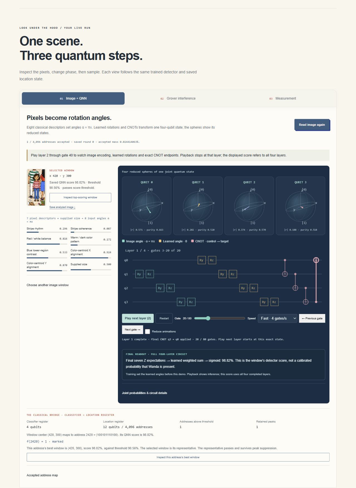
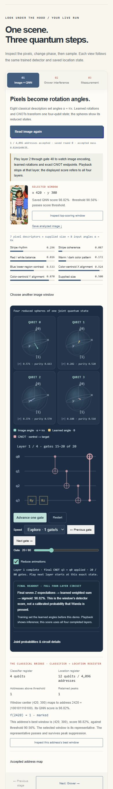

# Iteration 16 private deployment checks

Recorded 2026-10-11T11:11:22.254474+00:00. Exact source `2f3f836e5d13df81f32abc040f101a2959c04ee0`, version
`appgprj_6ac9ed0456008191aafac54f8d5af4d1~appgver_7277a3127a88819190d9eed676771a5a`, deployment `appgdep_6acb6db2fa84819194c044f570f6c8db`: **succeeded**.
Post-deployment audience: owner/custom, one user, zero groups and zero external
visitors. The schoolbus deployment is unchanged.

The existing QNN Play control now pauses at each actual layer endpoint, showing completed CNOT states and explicit next-layer continuation. Final-score/inference scope is clearer inside the same three-stage lesson. Actual local/hosted layer, phone, game, guide, empty-scene and full-outcome-export checks preserve the frozen detector and Grover state.

- Exact source2f3f836e5d13df81f32abc040f101a2959c04ee0 privately deployed terminal-succeeded to the existing Site. Post-deployment owner/custom audience remains one user, zero groups and external visitors.
- Fresh hosted page enables Read before any Find, preserving repaired bootstrap. Actual Fast playback stops at20 with Play next layer(2), layer1 map/finalCNOT after caption and same mixed reduced-state values as local.
- Manual full-circuit End reaches80, disables Play and shows completed layer4. The actual4096 Grover amplitudes/probabilities export equals local exactly, norm1, uniform round0 and no sample.
- Hosted390px phone Read and20 explicit reduced-motion clicks reach gate20 with correct CNOT after-state. Document375px wide with no overflow; all four reduced spheres, actual narrow gate slice and complete-score scope remain visible.
- Final hosted default Find returns point420,300. Existing four-click reduced-motion guide saves round1 mass0.21958353% with no sample; empty Park52 abstains and disables the guide.
- No hosted desktop/phone errors/warnings. Viewport restored, temporary QA tabs closed, prior review tabs preserved, new private review retained.

## Evidence and limits

- Engineering/heuristic UX and scientific review, not a measured novice learning study or new held-out accuracy.
- Frozen historical native298/300 and baseline299/300 belong to the original unseeded scene/known PNG/supplied-size domain. Park40/46 false acceptances, original failures and native/browser differences remain retained.
- Known Wanda PNG with supplied scale and fully visible targets; classical descriptors feed a simulated trained QNN. No arbitrary-person, unknown-size, occlusion, hardware or end-to-end quantum speedup claim.
- Physical page visibility/OS preference and multi-touch were not directly manipulated. Hidden-tab behavior is browser-checked; lifecycle/visibility policy unit-tested.
- Prior portability uses exact installed Windows packages copied to fresh extraction; npm installation/cross-platform behavior remain untested. Final bundle identity/tests are recorded separately after packaging.

These are QNN layer playback and interaction checks, not a new recognition benchmark or
a human learning study. The model, threshold, historical results and retained
Park size failures remain frozen. Read [the quick-start](../WANDA_QUICKSTART.md),
[package audit](WANDA_ITERATION14_PACKAGE_AUDIT.md) and
[current handoff](../WANDA_HANDOFF.md). No contest/public submission occurred.

