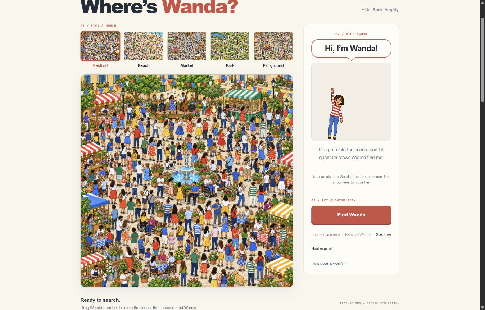

# Where’s Wanda — iteration 19 handoff

[Open the owner-private website](https://quantum-crowd-search.syrupyspool2.chatgpt.site).
Wanda now says **“Hi, I’m Wanda!”** in a speech bubble pointing toward her
portrait. Pick her up: a raised-hand sprite shrinks from the welcome box over
190ms, hangs from the pointer by her hand, and trails horizontal motion with
a damped swing. Release inside the map to place the existing standing Wanda;
an early release finishes pickup before placing from the rendered body center.
Release outside to cancel. Drag a placed Wanda off the map to return her to
the box. Remove and Start over remain available. Once she is placed, “I’m in
the scene!” is plain text, with the speech-bubble border, fill, shadow and tail
removed.

The empty Festival start, five named map thumbnails above it, right-hand Find
menu and connected **Image + QNN → Grover interference → Measurement**
explanation remain. The hanging pose is presentation-only artwork; the final
scene uses the original standing PNG. No model, threshold, scene artwork,
scanner input or quantum mathematics changed. The preview never enters
classifier inference.

## Actual checks and retained failures

- All **147 Node engineering tests** pass. JavaScript syntax, diff checks and
  the read-only frozen verifier pass: 11 files, seven source contracts and
  12 pixel fixtures, including the metadata erratum.
- Actual local mouse pickup hid the source portrait and showed the new pose
  shrinking from 239.8px through 208.4/157.7px to 103.8px, with changing
  rotation matrices. Two local searches returned measured (284,260) and
  (300,228). Keyboard placement remains available. Dragging a placed target
  from (420,300) past the right edge restored the portrait.
- The latest plain placed-message styling was actually checked after a quick
  pointer release: the 190ms pickup completed, preview hid and the message
  had transparent fill/border with no tail.
- Actual local 320px and 390px viewports keep five choices in one row without
  horizontal document overflow. The mobile bubble points toward the portrait.
  The explicit Reduce animations setting gave a constant 70.76px preview and
  static orientation; an outside release cancelled, and the setting was reset.
- Scratch numerical animation checks cover both directions, overshoot,
  settling and 1,500 irregular/reversed samples. They check motion stability,
  not recognition accuracy.
- Actual hosted pointer pickup showed the source at opacity zero, preview
  shrinking from 240.3px to 81.95px and changing rotation matrices. Early
  release completed pickup and cleared the ghost; the placed message had
  transparent border and no tail. The first arbitrary hosted placement
  returned **No match found**. This retained abstention was not repaired by
  model tuning or counted as successful recognition; see
  [the actual failure proof](../../screenshots/wanda-hanging-hosted-abstention-proof.png).
- After reset, hosted keyboard placement at the remembered default was found
  at **Measured point 420,300 / Found Wanda**. Dragging that placed target past
  the map edge restored the visible portrait and greeting bubble. The hosted
  warning/error console was empty, and the empty welcome was restored for
  review. These individual checks do not erase the arbitrary-drop abstention.
- Review caught a quick-release mismatch between interpolated preview and
  placement geometry; the owned animation now completes the 190ms pickup
  before committing its rendered center. Stale portrait painting during a
  native HTML drag led to captured pointer events for mouse as well as
  touch/pen. A probe ending inside the map was correctly counted as placement,
  not cancellation. Read the source QA for retained development/tool failures.

Hosted post-release gesture, default-point, off-map and console checks are
complete. A functioning pickup does not establish recognition at every
arbitrary drop location. The exact receipt and proofs retain both success and
abstention.

Read [source QA](../../../waldo-search-lab/docs/WANDA_ITERATION19_QA.md),
[hanging-pose provenance](../../../waldo-search-lab/docs/WANDA_HANGING_ASSET.md),
[quick-start](../../WANDA_QUICKSTART.md) and [exact receipt](../publication-receipt.json).
[Iteration 18’s handoff](WANDA_HANDOFF-iteration18.md) preserves the
initial invisible native preview and its actual hosted correction. The
[iteration 17 rehearsal](../WANDA_ITERATION17_HANDOFF.md) remains historical;
237.405 tool-driven seconds did not establish a two-minute spoken demo.

## Exact private release and scientific scope

Source `002574d248d81237e542b0c954185213eda9208a`; version
`appgprj_6ac9ed0456008191aafac54f8d5af4d1~appgver_5daa63b3a8bc819181549750493a7a87`; deployment
`appgdep_6acbd4091a308191aa1ede8ca65c2675`: terminal **succeeded** on the original crowd
Site. The separate schoolbus deployment and both owner-private Site identities
are preserved. No contest, public source/video or Qollab publication/submission
is authorized or performed.

The earlier iteration 19 source `fc36e1462aff0c4e120872cef32c0ca77a40a47e`
and deployment `appgdep_6acbd36dfe88819184901abe91438f36` also succeeded;
they were superseded by the latest request for an undecorated placed message,
not a failed deployment. The exact final identity above is current.

The frozen Wanda model remains
`d1f49aa304668d2826f36652ac70d0f51b64dc4eb86acfd2c0e7804f80ff4c88`,
threshold `0.9056472752971427`. Historical native 298/300 versus the matched
classical baseline’s 299/300 concerns the known standing PNG, five original
unseeded scenes, supplied scales and fully visible placements. Original misses,
browser/native differences and curated Park 40/46px false acceptances retain
their scopes. No training, reserved-test rerun or new accuracy claim occurred.
No arbitrary-person recognition, unknown-scale detection, occlusion, hardware
execution or end-to-end quantum speedup is established.

Physical touchscreen/pen, multi-touch, OS reduced-motion preference and
unfamiliar-user learning remain untested. Captured pointer handlers and actual
responsive/keyboard checks do not establish physical touch behavior. The prior
portable-startup proof remains the [iteration 14 audit](../WANDA_ITERATION14_PACKAGE_AUDIT.md).

## Resume here

Build on the published bubble and hanging pickup. Preserve the final standing
target and same three technical stages. Check the next observed usability gap,
physical touch/pen when available, and a privately timed spoken walkthrough
including the welcome gesture. Preserve frozen evidence and predeclare future
domain/model studies before new reserved testing.

The user authorized ongoing development synchronization to the existing
private `goesixteen/quantum-image-search` repository. The repository snapshot
and local bundle have separate records; consult
[the exact GitHub receipt](GITHUB_SYNC_RECEIPT.json) for the commit actually
pushed. Sites and GitHub have separate histories. No public contest materials.

The hourly heartbeat remains active. Maximum one agent usage reset tonight;
**zero agent resets consumed, one reset remaining at the latest observation**.
The earlier two-to-one account change had an unknown actor/cause. Preserve
the remaining reset for the user and read
[the resource ledger](../OVERNIGHT_RESOURCE_BUDGET.json) on resumption. No agent
reset, purchase or billing change occurred.

[Placed-message proof](../../screenshots/wanda-bubble-placed-hosted-proof.png) shows the
undecorated text after placement.
